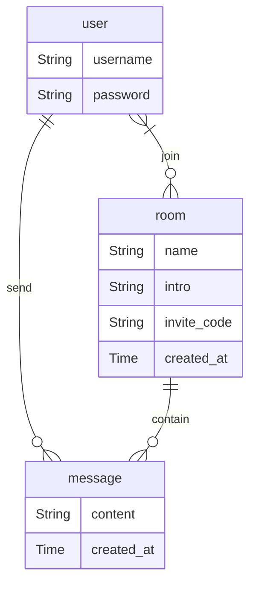
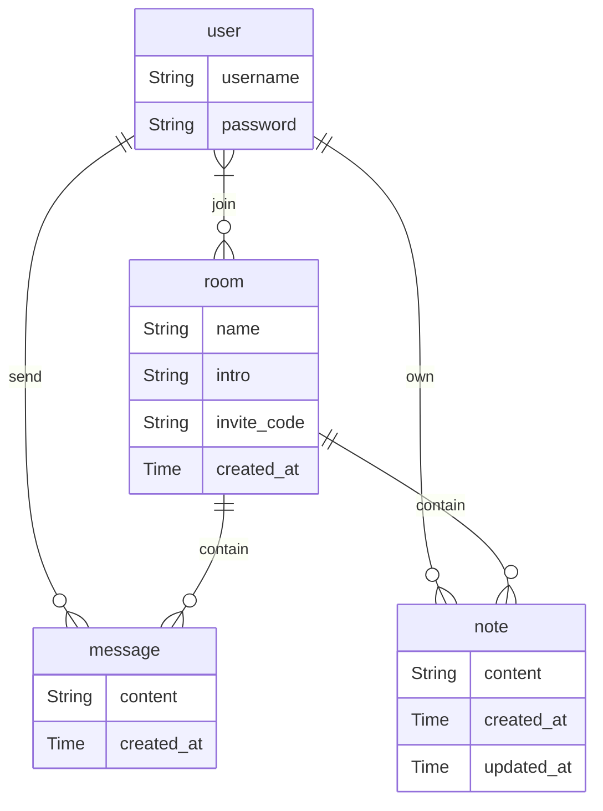

# 数据库设计

> 至少一半的屎山，来源于烂的数据库设计

### 步骤

1. 需求分析
2. 概要设计（E-R 图）
3. 表和字段设计

### 1. 分析需求

_所有涉及到数据在多人、多终端之间共享、同步的功能，都要用到数据库。_

以下是本工程希望实现的基本功能

- 用户注册、登录
- 会议创建、加入
- 会议中的聊天室

### 2.1 标识实体（Entity）

_需求中的所有“不可分拆物”，及它们的属性。_

- 用户（用户名、密码）
- 会议（名称、介绍、邀请码、创建时间）
- 消息（消息体，创建时间）

### 2.2 标识关系（Relation）

_与两个或多个实体有关系的信息。_

- 用户加入会议（用户——会议）
- 用户在会议中发出消息（用户——会议——消息，可分拆为 用户——消息 + 会议——消息）

### 2.3 E-R 图

### 3.0 设计范式

- 第一范式：要求数据库的每一列都是不可分割的原子数据项
- 第二范式：要求表中每一列都和主键相关，而不能只与主键的某一部分相关（每张表只描述一件事）
- 第三范式：要求表中每一列数据和主键直接相关，而不能间接相关

### 3.1 设计表

_一般来说，一个实体对应一张表，多对多的关系也可对应一张表。_

| 表        | 字段        | 数据类型  | 主键 | 外键      |
| --------- | ----------- | --------- | ---- | --------- |
| user      | uuid        | uuid      | 是   |           |
|           | username    | text      |      |           |
|           | password    | text      |      |           |
| room      | uuid        | uuid      | 是   |           |
|           | name        | text      |      |           |
|           | intro       | text      |      |           |
|           | invite_code | text      |      |           |
|           | created_at  | timestamp |      |           |
| user_room | user_uuid   | uuid      | 是   | user.uuid |
|           | room_uuid   | uuid      | 是   | room.uuid |
| message   | uuid        | uuid      | 是   |           |
|           | user_uuid   | uuid      |      | user.uuid |
|           | room_uuid   | uuid      |      | room.uuid |
|           | content     | text      |      |           |
|           | created_at  | timestamp |      |           |

注：由于使用的是 PostgreSQL，其`text`类型指长度可变的字符串，与其他数据库可能不同（[PostgreSQL: Documentation: 16: Chapter 8. Data Types](https://www.postgresql.org/docs/current/datatype.html)）

---

## 作业补充：会议便签纸（选项 C）

> 需求：用户可以为每个会议创建一张便签纸，便签纸仅创建者本人可见。

### 1. 分析需求

在原有「用户注册、登录 / 会议创建、加入 / 会议中的聊天室」基础上新增：

- 用户在某会议中拥有一张自己的便签纸，可在上面记录要点与待办
- 同一用户在同一会议只有一张便签纸；不同用户的便签互相不可见

### 2.1 标识实体

- 用户（用户名、密码）
- 会议（名称、介绍、邀请码、创建时间）
- **便签（内容、创建时间、修改时间）** ← 新增

### 2.2 标识关系

- 用户加入会议（用户——会议）
- 用户在会议中发出消息（用户——会议——消息）
- **用户在某会议拥有便签纸（用户——会议——便签）** ← 新增
  - “每个会议一张”意味着约束 `(user_uuid, room_uuid)` 唯一

### 2.3 E-R 图

### 3.1 新增表设计

| 表   | 字段       | 数据类型  | 主键 | 外键      | 约束                                          |
| ---- | ---------- | --------- | ---- | --------- | --------------------------------------------- |
| note | id         | uuid      | 是   |           | 默认 `gen_random_uuid()`                      |
|      | user_uuid  | uuid      |      | user.uuid | 级联删除/更新；`(user_uuid, room_uuid)` 唯一  |
|      | room_uuid  | uuid      |      | room.uuid | 级联删除/更新                                 |
|      | content    | text      |      |           |                                               |
|      | created_at | timestamp |      |           | 默认当前时间                                  |
|      | updated_at | timestamp |      |           | 默认当前时间，更新时自动刷新                  |

### 4. 仅自己可见的两种保障

1. 数据库层：便签行包含 `user_uuid`（属主），查询与修改都带上属主条件；
2. API 层（Hasura）：`user` 角色的 `insert/select/update/delete` 权限均绑定会话变量
   `X-Hasura-User-Id`，且 `insert` 使用 `set: { user_uuid: X-Hasura-User-Id }`，
   客户端无法伪造属主。配置文件见
   `database/hasura/metadata/databases/workshop/tables/public_note.yaml`。

### 5. 落地文件

| 文件 | 说明 |
| ---- | ---- |
| `database/sql/note.sql` | PostgreSQL 版建表 + 触发器 + 示例数据（Hasura/Neon 环境执行） |
| `database/sql/note_mysql.sql` | 同设计的 MySQL 9.x 版（本机实测通过） |
| `database/graphql/note.graphql` | 创建/查询/修改/删除便签的 GraphQL 操作 |
| `database/hasura/metadata/databases/workshop/tables/public_note.yaml` | note 表的 Hasura 元数据与权限 |

